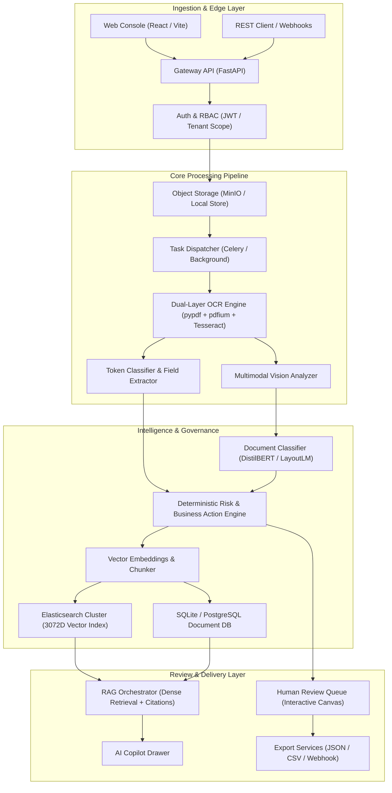

# DocuMatrix AI

<div align="center">


**Autonomous Enterprise Document Intelligence and Multimodal Decision Platform**

*High-throughput document processing engine combining dual-layer OCR, multimodal vision classification, deterministic risk analytics, vector-retrieval RAG, and human-in-the-loop review queues.*

[Key Features](#-key-features) • [Architecture](#-architecture) • [Risk Classification Matrix](#-risk-classification-matrix) • [Technology Stack](#-technology-stack) • [Getting Started](#-getting-started) • [API Reference](#-api-reference)

</div>

---

## 🌟 Overview

Enterprise document processing historically suffers from brittle optical character recognition (OCR), hallucinations in generative models, and an absence of verifiable auditability. Unlike conventional solutions that treat documents as flat text or route unverified outputs straight to production databases, **DocuMatrix AI** delivers a resilient, audit-grade document intelligence architecture.

DocuMatrix AI features:
- **Dual-Layer Extraction**: Combines native digital PDF parsing, Windows OCR, Tesseract fallback, and embedded asset decomposition to capture both machine-encoded text and physical scanned image layers.
- **Multimodal Visual Intelligence**: Classifies visual assets into individual portraits, group gatherings, landscape scenery, and scanned government credentials with deep attribute detection (facial orientation, eye gaze, attire color, and background illumination).
- **Deterministic Risk Governance**: Evaluates business transactions against configurable rule sets without black-box drift, calculating spend anomalies, signature verification, and compliance exceptions.
- **Tenant-Isolated Dense RAG**: Semantic vector retrieval coupled with verified chunk-level citations and direct SQLite database fallback when external search clusters are offline.
- **Active Human-in-the-Loop Review**: Multi-pane review workstation with execution lineage replay, interactive document canvas, PII redaction mode, and an AI copilot.

---

## 🏗️ Architecture

The following diagram illustrates the complete end-to-end data flow and processing topology:



---

## ⚡ Key Features

- **Multimodal Vision Intelligence**: Automatically identifies and categorizes images. For individual portraits, it provides deep biometric descriptions (face orientation, eye gaze, attire, and lighting). For government ID cards (Aadhaar, PAN), it applies credential-specific parsing without misclassifying documents as natural scenery.
- **Robust Dual-Layer PDF Processing**: Dual-engine extraction parses digital vector streams while isolating embedded graphic assets for secondary vision analysis, guaranteeing no text or imagery is missed.
- **Dense Vector RAG with Verified Citations**: Natural language search across enterprise document corpuses with chunk citations, page numbers, match percentages, and verifiable source references.
- **Dynamic Review Explorer & Workspace**: Explorer sidebar organizing files into Invoices, Legal Contracts, Compliance Audits, and Visual Media. Includes zoom/pan/rotate controls, live OCR streams, and one-click JSON/CSV exports.
- **Context-Aware AI Copilot**: Document assistant that welcomes users, explains field values, provides risk rationales, describes visual attributes, and searches across tenant archives.
- **Workflow Designer**: Visual canvas for pipeline orchestration with node dependency validation, minimap, drag-and-drop connections, and node inspectors.
- **Zero Hallucination Compliance Guard**: Deterministic business action engine enforcing spend thresholds, signature validation, vendor whitelist verification, and HIPAA/PII redaction rules.

---

## 📊 Risk Classification Matrix

DocuMatrix AI classifies documents and operational actions through a deterministic rule matrix:

| Document Category | Trigger Criteria | Risk Profile | Automated Action | Verification Protocol |
|:---|:---|:---:|:---|:---|
| **High-Value Invoice** | Total Amount > $50,000.00 USD | **HIGH** | Escalate to VP Finance | 3-way matching against purchase order and vendor history |
| **Vendor Invoice** | Standard Spend <= $50,000.00 USD | **LOW** | Auto-Pay Approved | Bank account validation and duplicate invoice detection |
| **Commercial Contract** | Missing counter-party signature | **HIGH** | Request Signature | Legal review queue notification with clause diff |
| **Healthcare Audit** | Critical audit findings > 0 | **MEDIUM** | Schedule Remediation | 30-day encryption key rotation and compliance tracking |
| **Identity Credential** | Aadhaar / PAN card detected | **LOW** | Secure Redaction Active | Automated masking of national identifier numbers |
| **Visual Portrait** | Single individual photo | **LOW** | Profile Intelligence Verified | Quality assessment (orientation, lighting, gaze) |

---

## 🛠️ Technology Stack

- **Frontend Application**: React 18, Vite, React Router v6, Framer Motion, Lucide Icons, xyflow ReactFlow v12
- **Backend Services**: FastAPI, Uvicorn, Python 3.11+, Pydantic v2, SQLAlchemy ORM
- **Document Processing**: PyPDF, PDFium, Pillow (PIL), Windows Media OCR, Tesseract OCR
- **Intelligence & RAG**: Dense Vector Embeddings (3072D), BM25 Retrieval, SentenceTransformers, Rerankers
- **Data & Storage**: SQLite / PostgreSQL, MinIO Object Storage, Redis Cache
- **Observability**: Prometheus Metrics, Structured Event Streams, SOC2 Audit Logging

---

## 🚀 Getting Started

### Prerequisites
- Python 3.11 or higher
- Node.js 18 or higher (with npm)
- Git

### Installation

1. **Clone the repository:**
   ```bash
   git clone https://github.com/your-username/DocuMatrix-AI.git
   cd DocuMatrix-AI
   ```

2. **Backend Setup:**
   ```bash
   cd backend
   python -m venv venv
   # On Windows:
   .\venv\Scripts\activate
   # On macOS/Linux:
   source venv/bin/activate

   pip install -r requirements.txt
   ```

3. **Frontend Setup:**
   ```bash
   cd ../frontend
   npm install
   ```

4. **Running Development Servers:**
   - **Backend API:**
     ```bash
     cd backend
     python -m uvicorn app.main:app --host 0.0.0.0 --port 8000 --reload
     ```
   - **Frontend UI:**
     ```bash
     cd frontend
     npm run dev
     ```

5. **Access the application:**
   - Web Application: `http://localhost:5173`
   - Interactive API Docs: `http://localhost:8000/docs`

---

## 🔌 API Reference

### Document Management & Processing

| Method | Endpoint | Parameters | Description |
|:---|:---|:---|:---|
| `POST` | `/api/v1/documents/upload` | `multipart/form-data` (file) | Ingest document with automated background OCR and classification |
| `GET` | `/api/v1/documents` | None | Retrieve tenant-isolated list of registered documents |
| `GET` | `/api/v1/documents/{id}/extraction` | `id` (UUID) | Retrieve extracted fields, OCR text, visual summary, and risk profile |

### Semantic Search & RAG

| Method | Endpoint | Parameters | Description |
|:---|:---|:---|:---|
| `POST` | `/api/v1/search/query` | `{"text": "query string"}` | Query document repository with dense retrieval and verified citations |
| `POST` | `/api/v1/ask` | `{"query": "query string"}` | Synthesize answers from document chunks with chunk references |
| `GET` | `/api/v1/semantic` | `q` (string) | Vector similarity search across document text chunks |

### Observability & System Health

| Method | Endpoint | Parameters | Description |
|:---|:---|:---|:---|
| `GET` | `/health` | None | Multi-service health probe (database, cache, storage, ML engines) |
| `GET` | `/metrics` | None | Prometheus telemetry metrics export |

---

## 📄 License & Attribution

This project is licensed under the Apache License 2.0. Built for enterprise document automation, intelligence verification, and governance.
